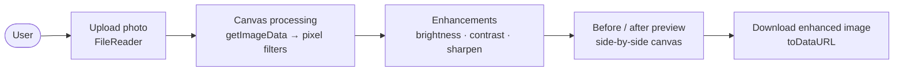

# ai-photo-enhancer

An early **AI photo enhancer** experiment (static HTML page).

Static single-page demo — open `index.html` in a browser to try it.

## How it works

Upload a photo, adjust the enhancement, and download the result — everything runs in the browser, no upload to a server.

## Architecture

