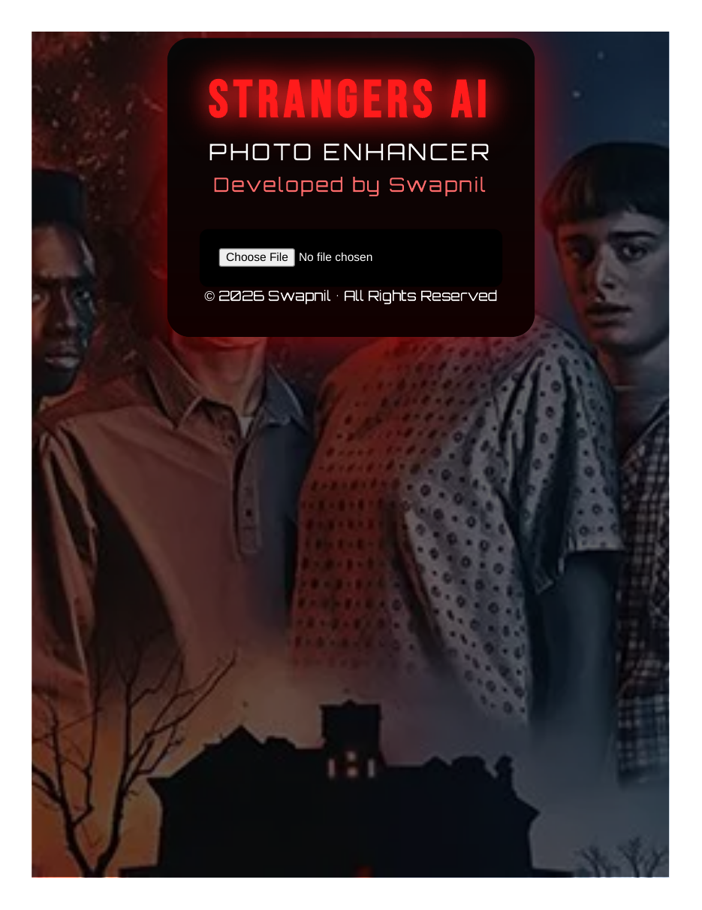
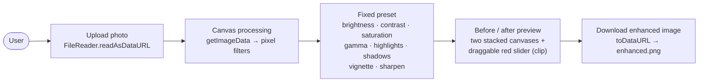

# ai-photo-enhancer

A static single-page **photo enhancer demo** — upload a photo, get a brighter, sharper version, and download it. Everything runs in the browser; nothing is uploaded anywhere.

**Live demo:** https://ai-photo-enhancer-thiteswapnil1212-hues-projects.vercel.app/

> **Not AI.** Despite the "Strangers AI" name shown on the page, there is no AI model and no API call anywhere in this project. The enhancement is a fixed set of Canvas pixel filters (brightness, contrast, saturation, gamma, sharpen) applied with `getImageData` / `putImageData`. The name is branding only.

## Screenshots



Home page — Stranger Things poster background with the 'STRANGERS AI / PHOTO ENHANCER' card and Choose File button (empty state, no photo uploaded). Screenshot of the live demo, 20 Nov 2026.

## What it does

- **Upload a photo** from your device (`<input type="file" accept="image/*">`)
- **Enhance it automatically** — one fixed preset, no sliders to adjust
- **Compare before / after** — drag the red line across the photo to reveal the original on one side and the enhanced version on the other
- **Download the result** as `enhanced.png`
- **Reset** to start over with a different photo

## How to use it

1. Open the [live demo](https://ai-photo-enhancer-thiteswapnil1212-hues-projects.vercel.app/) — or open `index.html` in any browser, no build step needed.
2. Choose a photo with the file picker.
3. Wait for the short loading animation, then drag the red line to compare the original with the enhanced version.
4. Click **Download Enhanced Image** to save the result, or **Reset** to try another photo.

## What the enhancement actually does

The whole pipeline is one fixed preset in `enhanceImage()` — the same adjustments for every photo:

| Step | What happens | Value |
|---|---|---|
| Auto brightness | Brightness is nudged up or down based on the photo's average brightness | `1 + (128 − avg) / 256 × 0.2` |
| Contrast | Pivots every channel around 128 | × 1.1 |
| Saturation | Pushes each channel away from its grey value | × 1.08 |
| Gamma | Darkens mid-tones very slightly (128 → ~125) | 1.03 |
| Highlight boost | Bright channels get a lift | +10 above 200 |
| Shadow boost | Dark channels get a lift | +8 below 50 |
| Black point | Near-black channels are deepened | −5 below 20 |
| Vignette | Edges are darkened toward the corners | strength 0.12 |
| Sharpen | 3×3 convolution kernel | `[0,-1,0, -1,5,-1, 0,-1,0]` |

Every value is clamped to 0–255. There are **no user-adjustable controls** — the enhancement is not tunable; it is one preset applied the same way every time.

### Filter pipeline (step by step)

The exact order inside `enhanceImage()` in `index.html` — one pass over the pixels, then a separate sharpen pass:

```mermaid
flowchart TB
    Pick["Choose a photo<br/><input type=file accept=image/*>"]
    Read["FileReader.readAsDataURL(file)<br/>loads into a temp Image"]
    Wait["Fixed 5 s loading overlay<br/>STRANGERS AI EDITING..."]
    Draw["drawImage to both canvases<br/>originalCanvas + enhancedCanvas"]
    Get["getImageData(0, 0, w, h)"]
    Avg["Average brightness first<br/>mean of (R+G+B)/3 over the ORIGINAL pixels"]
    Loop["Per-pixel loop — every pixel, R/G/B in this order"]
    BC["Brightness × (1 + (128 − avg) / 256 × 0.2)<br/>then contrast pivots around 128 (× 1.1)"]
    Sat["Saturation × 1.08<br/>away from grey (0.3R + 0.59G + 0.11B)"]
    Gam["Gamma 1.03<br/>255 × (d/255)^1.03 — darkens mid-tones slightly"]
    Tone["Highlight +10 if channel > 200<br/>Shadow +8 if channel < 50<br/>Black point −5 if channel < 20<br/>clamped to 0–255 after each step"]
    Vig["Vignette × (1 − 0.12 × dist / maxDist)<br/>corners darken toward 0.88×"]
    Put1["putImageData — first pass done"]
    Sharp["Sharpen (second pass)<br/>3×3 kernel [0,-1,0, -1,5,-1, 0,-1,0]<br/>computed on a copy of the pixels"]
    Put2["putImageData — final pixels"]
    Show["Show the canvases · enhanced clipped to left half<br/>slider at 50% · Download + Reset buttons appear"]
    DL["Download<br/>enhancedCanvas.toDataURL() → enhanced.png"]
    Pick --> Read --> Wait --> Draw --> Get --> Avg --> Loop
    Loop --> BC --> Sat --> Gam --> Tone --> Vig --> Put1
    Put1 --> Sharp --> Put2 --> Show --> DL
```



Details the table alone does not show:

- The average brightness is measured on the **original** pixels before any filter runs, so the brightness nudge is the same for the whole photo.
- Saturation is measured against a luminance-weighted grey (`0.3R + 0.59G + 0.11B`), not a plain average.
- The sharpen pass skips the outermost 1 px border (its loop runs `y = 1 .. h − 2`, `x = 1 .. w − 2`), so edge pixels keep their first-pass values.
- The loading overlay is a fixed 5-second `setTimeout` — it plays even if the processing finishes faster, and it only ever shows once per page load.

## How it works



The page is a single `index.html` (12,949 bytes). The original and enhanced versions live on two stacked canvases; the enhanced one is clipped with CSS `clip: rect(...)`, and dragging the red handle moves the clip edge. A 5-second loading overlay ("STRANGERS AI EDITING...") plays while the image is processed.

## Tech stack

| Layer | Choice |
|---|---|
| App | Single static `index.html` — no framework, no build step, no backend |
| Image processing | Canvas 2D API (`getImageData` / `putImageData`, per-pixel loops) |
| Fonts | Google Fonts — Bebas Neue + Orbitron |
| Styling | Inline CSS, dark red/black theme, responsive down to 400 px |
| Hosting | Vercel (static) |

## Where everything runs (deployment)

```mermaid
flowchart TB
    subgraph Vercel ["Vercel — static hosting"]
        HTML["index.html<br/>the whole app: markup + CSS + JS in one file"]
    end
    subgraph Browser ["Visitor's browser — everything runs here"]
        File["File picker<br/><input type=file accept=image/*>"]
        Canvas["Canvas 2D<br/>getImageData / putImageData"]
        DL["Download<br/>toDataURL() → enhanced.png"]
    end
    subgraph ThirdParty ["Third-party resources — loaded at page load"]
        Fonts["Google Fonts<br/>Bebas Neue + Orbitron"]
        BG["Bing image CDN<br/>poster background (hotlinked)"]
    end
    User(["User"]) --> HTML
    HTML --> File
    File --> Canvas
    Canvas --> DL
    HTML -.-> Fonts
    HTML -.-> BG
```



There is **no backend, no database, and no API call** for the enhancement — `index.html` contains zero `fetch` / `XMLHttpRequest` calls. The only network requests besides the page itself are the Google Fonts stylesheet and the hotlinked Bing background image. If either of those dies, the page still works (fonts fall back, background goes blank); the enhancer itself needs no network at all once the page has loaded. The photo never leaves the browser.

## Project structure

```text
index.html     The whole app — markup, CSS and JavaScript in one file
README.md      This file
```

That is the entire repo: two files, no dependencies to install, no `package.json`.

## Run locally

```bash
# No install, no build — just open the file:
open index.html
# or serve it with any static server:
npx serve .
```

## Honest limits

- **No AI** — no model, no API key, no network call for the enhancement. The "AI" in the page title is branding.
- **No adjustable settings** — brightness, contrast and the rest are fixed values in the code, not sliders.
- **No backend, no upload, no storage** — your photo never leaves your browser.
- **PNG-only download** — the result always saves as `enhanced.png`, whatever the input format was.
- **Slow on very large photos** — the enhancement loops over every pixel twice in JavaScript, so big images take noticeably longer.
- **Background image is hotlinked** — the page background loads from a Bing image URL (`tse1.mm.bing.net`); if that link dies, the background breaks (the enhancer itself still works).
- **Fixed 5-second loading animation** — the overlay plays for 5 seconds regardless of how fast the processing actually finishes.
- **Headings clip on wide desktop screens** — the card is at most 420 px wide but the title is sized in viewport units (`8vw`), so at a 1919 px-wide window "STRANGERS AI" and "PHOTO ENHANCER" run past the card edge (seen live 20 Nov 2026).
